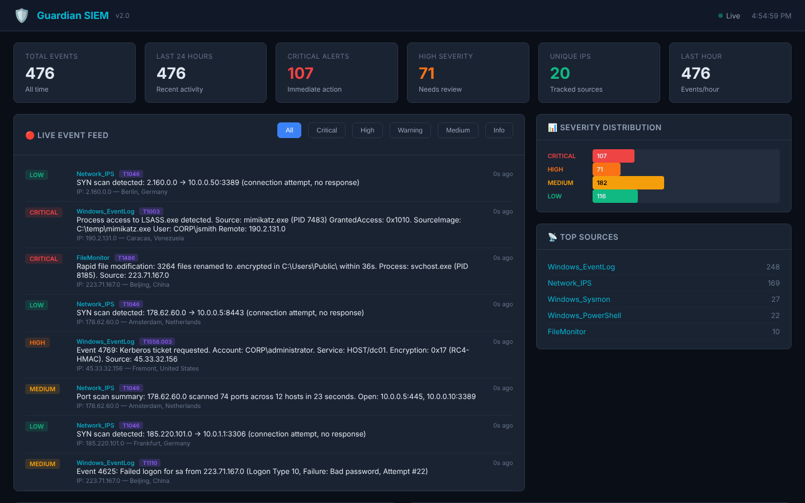

# 🛡️ Guardian SIEM

**A working SIEM written from scratch in Python: log and packet ingestion, a YAML + Sigma + YARA detection engine, MITRE ATT&CK mapping, threat-intel enrichment, active response, and a live SOC dashboard. 176 automated tests, run in CI on Linux and Windows.**

[](https://github.com/DoctorMen/Guardian-SIEM-v2.0/actions/workflows/ci.yml)
[](https://python.org)
[](LICENSE)
[](Dockerfile)



*The dashboard above is running against the built-in demo traffic generator (`generate_noise.py`). The IPs and hosts are simulated, but every alert went through the real pipeline: ingestion, then the rules and Sigma engines, then ATT&CK tagging and GeoIP.*

## Try it in 60 seconds

```bash
git clone https://github.com/DoctorMen/Guardian-SIEM-v2.0.git && cd Guardian-SIEM-v2.0
python -m venv .venv && source .venv/bin/activate      # Windows: .venv\Scripts\activate
pip install -r requirements.txt
python guardian_dash.py          # dashboard on http://127.0.0.1:5001
python generate_noise.py --fast  # in a second terminal: stream simulated attacks
python -m pytest tests/ -q       # 176 tests
```

## What this project demonstrates

| Skill | Where to look |
|---|---|
| Detection engineering (Sigma, YARA, threshold and sliding-window rules) | [`sigma_engine.py`](sigma_engine.py), [`rules_engine.py`](rules_engine.py), [`config/sigma_rules/`](config/sigma_rules/) |
| Mapping detections to MITRE ATT&CK and finding coverage gaps | [`mitre_tagger.py`](mitre_tagger.py), [`attack_simulator.py`](attack_simulator.py) |
| Log parsing: Windows Event Log, Sysmon, syslog (RFC 3164/5424), CloudTrail, Azure Activity | [`log_ingestor.py`](log_ingestor.py), [`syslog_receiver.py`](syslog_receiver.py), [`cloud_honeypot.py`](cloud_honeypot.py) |
| Network traffic analysis (port-scan, rate and DNS anomaly detection with Scapy) | [`passive_ips.py`](passive_ips.py) |
| Threat-intel enrichment (AbuseIPDB, VirusTotal, with caching) | [`threat_intel.py`](threat_intel.py) |
| Secure coding: a self-audit that fixed 14 findings, with auth and CSRF on the dashboard | [`SECURITY.md`](SECURITY.md), [`auth.py`](auth.py) |
| Engineering trade-offs written down | [`DESIGN.md`](DESIGN.md) (7 architecture decision records) |
| Testing and CI | [`tests/`](tests/) (176 tests), [`.github/workflows/ci.yml`](.github/workflows/ci.yml) |

---

## Features

### Core Detection & Monitoring

| Feature | Description |
|---------|-------------|
| **Real-Time Dashboard** | Dark-themed SOC dashboard with live event feed via WebSocket, severity charts, and filter controls |
| **Rules Engine** | YAML-configurable detection rules with regex matching, threshold counting, and sliding windows |
| **SIGMA Rules** | Industry-standard SIGMA detection format — load `.yml` rules with field matching, wildcards, modifiers, and condition logic (`and`/`or`/`not`) |
| **YARA Scanner** | File and memory scanning against YARA rules for malware detection, with SHA-256 hashing and directory scanning |
| **MITRE ATT&CK** | Every alert mapped to ATT&CK technique IDs and tactics with an interactive heatmap |
| **Threat Intelligence** | Automated IP reputation checks via AbuseIPDB and VirusTotal APIs with local caching |
| **GeoIP Mapping** | Attack origin map powered by Leaflet.js with MaxMind GeoLite2 / ip-api.com fallback |
| **Passive IPS** | Scapy-based network monitor detecting rate anomalies, port scans, and DNS anomalies |

### Ingestion & Response

| Feature | Description |
|---------|-------------|
| **Log Ingestion** | Windows Event Log, Sysmon, and file-based log parsing (Apache, Nginx, custom) |
| **Syslog Receiver** | Multi-protocol syslog server (UDP + TCP) with RFC 3164 and RFC 5424 parsing, structured data extraction |
| **Active Response** | Automated IP blocking via Windows Firewall (`netsh`), with whitelist (CIDR), rate limiting, cooldown, dry-run mode, and full audit trail |
| **Alert Notifications** | Email (SMTP) and Slack webhook alerting with deduplication and rate limiting |

### Operations & Reporting

| Feature | Description |
|---------|-------------|
| **Dashboard Authentication** | Session-based + API key auth with role-based access control (admin / analyst / viewer), bcrypt password hashing |
| **PDF Report Generation** | Professional security reports via `reportlab` (PDF) with HTML fallback — executive summary, severity breakdown, top IPs, MITRE coverage, recent critical events |
| **Incident Report Generator** | NIST SP 800-61 format incident reports with Executive Summary, Technical Analysis, Kill Chain visualization, IOC extraction, Impact Assessment, Remediation Plan, and Lessons Learned |
| **Identity Verifier** | Windows Authenticode signature validation against trusted publisher lists |
| **Docker Deployment** | Full `docker-compose` stack — dashboard, IPS, and log ingestor in separate containers |
| **Unit Tests** | Comprehensive test suite (176 tests) covering all core and advanced modules |

### Purple Team Lab

| Feature | Description |
|---------|-------------|
| **Attack Simulator** | 11 MITRE ATT&CK techniques with realistic Windows/network telemetry — Mimikatz, Kerberoasting, brute force, ransomware, lateral movement, exfiltration |
| **Attack Campaigns** | 3 pre-built multi-stage campaigns: APT29 (Cozy Bear), human-operated Ransomware, and Insider Threat |
| **Detection Coverage** | Automated coverage reporting — shows which techniques were detected and which are detection gaps |
| **30 Detection Rules** | 18 YAML + 12 SIGMA rules covering credential access, lateral movement, defense evasion, persistence, exfiltration, and impact |
| **Cloud Honeypot Parser** | Parse AWS CloudTrail + Azure Activity Logs to analyze bot scanning, unauthorized access, and known scanner fingerprints (Shodan, Censys, BinaryEdge) |
| **Architectural Decisions** | [DESIGN.md](DESIGN.md) with 7 ADRs documenting every major engineering trade-off |

---

## Architecture

```
┌──────────────────┐    ┌──────────────┐    ┌─────────────────┐
│   Passive IPS    │───▶│              │    │  Rules Engine   │
│ (Scapy capture)  │    │              │───▶│ (YAML rules)    │
└──────────────────┘    │              │    └────────┬────────┘
                        │  Event Bus   │             │
┌──────────────────┐    │  (Singleton) │    ┌────────▼────────┐
│  Log Ingestor    │───▶│              │    │  SIGMA Engine   │
│ (WinEvt/Sysmon/  │    │              │    │ (.yml rules)    │
│  File tailing)   │    │              │    └────────┬────────┘
└──────────────────┘    │              │             │
                        │              │    ┌────────▼────────┐
┌──────────────────┐    │              │    │ MITRE Tagger    │
│ Syslog Receiver  │───▶│              │    │ (ATT&CK mapping)│
│ (UDP + TCP)      │    │              │    └────────┬────────┘
└──────────────────┘    │      │       │             │
                        │      │       │    ┌────────▼────────┐
┌──────────────────┐    │      ▼       │    │ Threat Intel    │
│ Identity Verifier│    │  SQLite DB   │    │ (AbuseIPDB / VT)│
│ (Authenticode)   │    │              │    └────────┬────────┘
└──────────────────┘    └──────┬───────┘             │
                               │            ┌────────▼────────┐
                        ┌──────▼───────┐    │  GeoIP Lookup   │
                        │   Flask +    │    │ (MaxMind/ip-api)│
                        │  WebSocket   │    └────────┬────────┘
                        │  Dashboard   │◀────────────┘
                        │ (Auth + API) │
                        └──┬────┬──┬───┘    ┌─────────────────┐
                           │    │  │        │ Alert Manager   │
                           │    │  └───────▶│ (Email / Slack) │
                           │    │           └─────────────────┘
                           │    │           ┌─────────────────┐
                           │    └──────────▶│ Active Response │
                           │                │ (Firewall block)│
                           │                └─────────────────┘
                           │                ┌─────────────────┐
                           └───────────────▶│ Report Generator│
                                            │ (PDF / HTML)    │
                                            └─────────────────┘

                        ┌──────────────────────────────────────┐
                        │           YARA Scanner               │
                        │  (file/memory scan on demand)        │
                        └──────────────────────────────────────┘
```

---

## Quick Start

### Prerequisites

- **Python 3.10+**
- **Windows** (for Identity Verifier and Windows Event Log ingestion; other modules work cross-platform)
- **Admin/elevated terminal** (required for raw packet capture)

### Installation

```bash
# Clone the repository
git clone https://github.com/DoctorMen/Guardian-SIEM-v2.0.git
cd Guardian-SIEM-v2.0

# Create and activate virtual environment
python -m venv .venv
.venv\Scripts\activate        # Windows
# source .venv/bin/activate   # Linux/macOS

# Install dependencies
pip install -r requirements.txt
```

### Run

```bash
# 1. Start the Dashboard (initializes DB automatically)
python guardian_dash.py

# 2. (Optional) Start the Passive IPS in another terminal (requires admin)
python passive_ips.py

# 3. (Optional) Start the Log Ingestor in another terminal
python log_ingestor.py
```

Open **http://localhost:5001** for the dashboard.

### Docker

```bash
# Build and launch all services
docker-compose up --build -d

# View logs
docker-compose logs -f
```

---

## Purple Team Lab

The Purple Team lab generates realistic attack telemetry through Guardian's full detection pipeline — validating that rules fire, alerts trigger, and reports capture forensic evidence.

### Attack Simulator

```bash
# List all available techniques and campaigns
python attack_simulator.py --list

# Run a specific MITRE ATT&CK technique
python attack_simulator.py --technique T1003     # Credential Dumping (Mimikatz)
python attack_simulator.py --technique T1558.003 # Kerberoasting
python attack_simulator.py --technique T1486     # Ransomware

# Run a full attack campaign (multi-stage)
python attack_simulator.py --campaign apt29       # APT29 kill chain (6 techniques)
python attack_simulator.py --campaign ransomware  # Human-operated ransomware (6 techniques)
python attack_simulator.py --campaign insider     # Insider threat (3 techniques)

# Run all techniques and check detection coverage
python attack_simulator.py --all
python attack_simulator.py --coverage
```

**Techniques (11):** T1003 (Mimikatz), T1110 (Brute Force), T1059.001 (PowerShell), T1046 (Port Scan), T1070.001 (Log Clearing), T1543.003 (Service Persistence), T1041 (Exfiltration), T1059 (Reverse Shell), T1558.003 (Kerberoasting), T1021.001 (RDP Lateral Movement), T1486 (Ransomware).

### Incident Reports

```bash
# Generate report from existing SIEM events
python incident_report.py --hours 24

# Simulate an attack and auto-generate the incident report
python incident_report.py --campaign apt29
python incident_report.py --campaign ransomware
python incident_report.py --title "INC-2025-042 Ransomware"

# Generate all sample reports for portfolio
python generate_sample_reports.py
```

Reports include: Executive Summary, Kill Chain Visualization, MITRE ATT&CK Mapping, Event Timeline, IOC Extraction, Impact Assessment, Remediation Plan (Immediate / Short-term / Long-term), and Lessons Learned.

### Cloud Honeypot

```bash
# Generate sample CloudTrail + Azure Activity logs (500+ events)
python cloud_honeypot.py --generate-sample

# Parse and analyze real cloud logs
python cloud_honeypot.py --file path/to/cloudtrail.json --format aws
python cloud_honeypot.py --analyze logs/honeypot/

# Emit honeypot events into the SIEM pipeline
python cloud_honeypot.py --generate-sample --emit --report
```

---

## Dashboard

The SOC dashboard provides:

- **Live Event Feed** — real-time events via WebSocket with severity filtering
- **Stats Cards** — total events, last 24h, critical alerts, unique IPs
- **Severity Distribution** — horizontal bar chart of event severities
- **Attack Origin Map** — Leaflet.js world map with GeoIP-plotted threat sources
- **MITRE ATT&CK Heatmap** — visual coverage of triggered techniques
- **Active Detection Rules** — table of all loaded YAML rules
- **Top Sources** — ranked list of event sources

---

## API Reference

### Core Endpoints

| Endpoint | Method | Description |
|----------|--------|-------------|
| `/` | GET | SOC Dashboard UI |
| `/api/events` | GET | Events (query params: `limit`, `severity`, `source`, `since`, `mitre_id`) |
| `/api/stats` | GET | Aggregate statistics (totals, severity breakdown, top sources) |
| `/api/mitre` | GET | MITRE ATT&CK technique data and trigger counts |
| `/api/geo` | GET | GeoIP data for all tracked source IPs |
| `/api/rules` | GET | Active detection rules from YAML config |
| `/api/alerts` | GET | Recent alert notifications |
| `/api/threat/<ip>` | GET | Threat intelligence lookup for a specific IP |
| `/api/geoip/<ip>` | GET | GeoIP resolution for a specific IP |
| `/api/health` | GET | System health check and module status |
| `/ws` | WebSocket | Real-time event stream |

### SIGMA Rules

| Endpoint | Method | Description |
|----------|--------|-------------|
| `/api/sigma/rules` | GET | List all loaded SIGMA rules with metadata |
| `/api/sigma/reload` | POST | Hot-reload SIGMA rules from disk |

### YARA Scanner

| Endpoint | Method | Description |
|----------|--------|-------------|
| `/api/yara/stats` | GET | YARA scanner statistics and loaded rules count |
| `/api/yara/results` | GET | Recent YARA scan results |
| `/api/yara/scan` | POST | Trigger on-demand file/directory scan (`path` in JSON body) |
| `/api/yara/reload` | POST | Reload YARA rules from disk |

### Active Response

| Endpoint | Method | Description |
|----------|--------|-------------|
| `/api/response/stats` | GET | Active response statistics (blocks, actions, rate) |
| `/api/response/blocked` | GET | Currently blocked IPs with block time and expiry |
| `/api/response/log` | GET | Full response audit log |
| `/api/response/block` | POST | Manually block an IP (`ip`, `reason` in JSON body) |
| `/api/response/unblock` | POST | Manually unblock an IP (`ip` in JSON body) |

### Reports

| Endpoint | Method | Description |
|----------|--------|-------------|
| `/api/reports` | GET | List all generated reports |
| `/api/reports/generate` | POST | Generate a new report (`type`: daily/weekly/monthly, `hours`) |
| `/api/reports/download/<filename>` | GET | Download a specific report file |

### Syslog

| Endpoint | Method | Description |
|----------|--------|-------------|
| `/api/syslog/stats` | GET | Syslog receiver statistics (messages received, errors, by source) |

### Authentication (when enabled)

| Endpoint | Method | Description |
|----------|--------|-------------|
| `/login` | GET/POST | Login page and form submission |
| `/logout` | GET | End session |
| `/api/auth/users` | GET | List users (admin only) |
| `/api/auth/users` | POST | Create user (admin only) |
| `/api/auth/users/<username>` | DELETE | Delete user (admin only) |
| `/api/auth/password` | POST | Change password |
| `/api/auth/apikey` | POST | Generate API key |

---

## Detection Rules

Rules are defined in `config/alert_rules.yaml`:

```yaml
rules:
  - name: "Brute Force Detection"
    description: "Multiple failed login attempts from the same source"
    source: ".*"
    pattern: "(failed login|authentication failure|4625)"
    severity: "HIGH"
    mitre_id: "T1110"
    mitre_tactic: "Credential Access"
    threshold: 5
    window_seconds: 60
    enabled: true
```

**Included rules:** Brute Force, Port Scan, Traffic Anomaly, Privilege Escalation, Log Tampering, Service Installation, Reverse Shell, Data Exfiltration, Unauthorized Access, Malware Signature, **Kerberoasting Detection**, **LSASS Credential Access**, **Ransomware File Encryption**, **Shadow Copy Deletion**, **RDP Lateral Movement**, **DNS Exfiltration**, **PowerShell Download Cradle**, **C2 Beacon Communication**.

Rules support regex patterns, source filtering, threshold counts with sliding windows, and hot-reload without restart.

---

## Threat Intelligence

Configure API keys via environment variables or `config/config.yaml`:

```bash
# Environment variables (recommended)
export ABUSEIPDB_API_KEY="your-key-here"
export VIRUSTOTAL_API_KEY="your-key-here"

# Or in config/config.yaml
threat_intel:
  abuseipdb:
    enabled: true
    api_key: "your-key-here"
```

Results are cached locally in SQLite to respect rate limits.

---

## Project Structure

```
Guardian_SIEM/
├── config/
│   ├── config.yaml              # Master configuration
│   ├── alert_rules.yaml         # Detection rules (18 YAML rules)
│   ├── mitre_mappings.yaml      # MITRE ATT&CK technique/tactic mappings
│   ├── sigma_rules/             # SIGMA detection rules (12 .yml files)
│   └── yara_rules/              # YARA scanning rules (.yar files)
├── database/                    # SQLite databases (auto-created)
├── reports/
│   ├── incidents/               # Professional incident reports (HTML)
│   └── honeypot/                # Cloud honeypot analysis reports (HTML)
├── logs/
│   └── honeypot/                # Cloud honeypot sample logs (JSON)
├── service_logs/                # Drop log files here for ingestion
├── static/
│   ├── css/dashboard.css        # SOC dashboard dark theme
│   └── js/dashboard.js          # Real-time event feed & charts
├── templates/
│   └── dashboard.html           # Dashboard HTML template
├── tests/                       # 176 unit tests across 15 test files
│   ├── test_event_bus.py
│   ├── test_rules_engine.py
│   ├── test_sigma_engine.py
│   ├── test_yara_scanner.py
│   ├── test_mitre_tagger.py
│   ├── test_threat_intel.py
│   ├── test_geoip.py
│   ├── test_alert_manager.py
│   ├── test_active_response.py
│   ├── test_auth.py
│   ├── test_report_generator.py
│   ├── test_syslog_receiver.py
│   ├── test_attack_simulator.py  # NEW: Purple team simulator tests
│   ├── test_incident_report.py   # NEW: Incident report tests
│   └── test_cloud_honeypot.py    # NEW: Cloud honeypot parser tests
│
├── # ── Core SIEM Modules ──
├── event_bus.py                 # Central event pipeline (singleton)
├── guardian_dash.py             # Flask dashboard + WebSocket + REST API
├── passive_ips.py               # Scapy network monitor (IPS)
├── log_ingestor.py              # Multi-source log ingestion
├── rules_engine.py              # YAML-based detection rules engine
├── sigma_engine.py              # SIGMA-format detection rule engine
├── yara_scanner.py              # YARA file/memory scanning
├── mitre_tagger.py              # MITRE ATT&CK enrichment
├── threat_intel.py              # AbuseIPDB + VirusTotal integration
├── geoip_lookup.py              # GeoIP resolution (MaxMind + ip-api.com)
├── alert_manager.py             # Email + Slack alerting
├── active_response.py           # Automated IP blocking (Windows Firewall)
├── auth.py                      # Dashboard authentication + RBAC
├── report_generator.py          # PDF/HTML security report generation
├── syslog_receiver.py           # Syslog server (UDP + TCP)
├── identity_verifier.py         # Windows Authenticode checker
│
├── # ── Purple Team / Portfolio ──
├── attack_simulator.py          # NEW: MITRE ATT&CK attack simulator (11 techniques, 3 campaigns)
├── incident_report.py           # NEW: Professional incident report generator (NIST SP 800-61)
├── cloud_honeypot.py            # NEW: Cloud honeypot log parser (AWS/Azure/GCP)
├── generate_sample_reports.py   # NEW: Portfolio demo report generator
├── DESIGN.md                    # NEW: 7 Architectural Decision Records
│
├── Dockerfile                   # Container image definition
├── docker-compose.yml           # Multi-service orchestration
├── requirements.txt             # Python dependencies
└── README.md
```

---

## Running Tests

```bash
# Run all tests
python -m pytest tests/ -v

# Run specific test module
python -m pytest tests/test_rules_engine.py -v

# Run with coverage (install pytest-cov first)
python -m pytest tests/ --cov=. --cov-report=term-missing
```

---

## Configuration

All configuration lives in `config/config.yaml`. Key settings:

| Setting | Default | Description |
|---------|---------|-------------|
| `dashboard.port` | 5001 | Dashboard server port |
| `ips.threshold` | 100 | Packets per window to trigger alert |
| `ips.window_seconds` | 5 | Sliding window size |
| `alerting.email.enabled` | false | Enable email notifications |
| `alerting.slack.enabled` | false | Enable Slack notifications |
| `threat_intel.abuseipdb.enabled` | false | Enable AbuseIPDB lookups |
| `threat_intel.virustotal.enabled` | false | Enable VirusTotal lookups |
| `log_ingestion.poll_interval_seconds` | 5 | Log polling frequency |
| `sigma.enabled` | true | Enable SIGMA rule evaluation in pipeline |
| `sigma.rules_directory` | config/sigma_rules | Path to SIGMA `.yml` rules |
| `yara.enabled` | true | Enable YARA scanning engine |
| `yara.rules_directory` | config/yara_rules | Path to YARA `.yar` rules |
| `active_response.enabled` | false | Enable automated IP blocking |
| `active_response.dry_run` | true | Log actions without executing firewall commands |
| `active_response.min_severity` | HIGH | Minimum severity to trigger response |
| `active_response.block_duration_minutes` | 60 | How long to block an IP |
| `auth.enabled` | false | Enable dashboard authentication |
| `auth.secret_key` | (random) | Flask session secret key |
| `syslog.enabled` | true | Enable syslog receiver |
| `syslog.udp_port` | 1514 | Syslog UDP listen port |
| `syslog.tcp_port` | 1514 | Syslog TCP listen port |
| `reports.output_directory` | reports | Directory for generated reports |

---

## SIGMA Rules

SIGMA rules are loaded from `config/sigma_rules/`. Guardian ships with 11 built-in rules:

- **Failed Logon Detection** — multiple failed Windows logon events (Event ID 4625)
- **Suspicious PowerShell** — encoded commands, hidden windows, bypass flags
- **Log Clearing** — Windows Security log cleared (Event ID 1102)
- **Reverse Shell** — common reverse shell patterns (`/bin/sh`, `bash -i`, `nc -e`)
- **Suspicious Service Install** — service installation via `sc create` or `New-Service`
- **Kerberoasting (RC4 Tickets)** — Kerberos TGS-REP with RC4-HMAC encryption (Event ID 4769)
- **LSASS Memory Access** — process accessing LSASS.exe for credential dumping (Sysmon Event 10)
- **RDP Lateral Movement** — anomalous Type 10 logons indicating lateral movement
- **Ransomware File Encryption** — rapid file renaming, ransom notes, shadow copy deletion
- **DNS Exfiltration** — high-volume DNS queries to suspicious domains
- **Encoded PowerShell** — Base64-encoded command execution

Add your own `.yml` rules following the [SIGMA specification](https://sigmahq.io/) — Guardian supports field matching, keyword matching, wildcards, and modifiers (`contains`, `startswith`, `endswith`, `re`).

---

## YARA Rules

YARA rules are loaded from `config/yara_rules/`. Guardian auto-creates a default ruleset covering:

- PowerShell obfuscation patterns
- Web shell indicators
- Mimikatz artifacts
- Ransomware note extensions
- Packed PE executables (UPX, Themida, VMProtect)

Scan files or directories on-demand via the `/api/yara/scan` endpoint. Requires `yara-python` (optional dependency).

---

## Active Response

When enabled, Guardian can automatically block threatening IPs via Windows Firewall:

```yaml
# config/config.yaml
active_response:
  enabled: true         # Enable blocking
  dry_run: true         # IMPORTANT: Set false to actually execute firewall rules
  min_severity: "HIGH"  # Minimum event severity to trigger
  block_duration_minutes: 60
  max_blocks_per_hour: 20
```

**Safety features:**
- **Disabled by default** — must explicitly enable
- **Dry-run mode** — logs actions without modifying firewall (default)
- **Whitelist** — private ranges (10.x, 172.16-31.x, 192.168.x), loopback, and custom CIDRs are never blocked
- **Rate limiting** — max 20 blocks per hour
- **Auto-expiry** — blocks automatically cleaned up after duration

---

## Authentication

Dashboard authentication is disabled by default. Enable it in config:

```yaml
auth:
  enabled: true
  secret_key: "your-secret-key"
```

**Roles:** `admin` (full access), `analyst` (read + scan), `viewer` (read-only)

A default admin account is created on first run with a **random password** printed to the console:
```
[Auth] Default admin created — username: admin  password: <random>
[Auth] ⚠️  SAVE THIS PASSWORD — it will not be shown again
```

Supports session-based auth (browser) and API key auth (`X-API-Key` header) for programmatic access.

---

## Security Audit

A comprehensive security audit identified and fixed **14 vulnerabilities** (2 Critical, 5 High, 5 Medium, 2 Low) including command injection, path traversal, stored XSS, hardcoded credentials, race conditions, and more.

Full details with CWE references, before/after code samples, and deployment best practices: **[SECURITY.md](SECURITY.md)**

---

## Roadmap

- [x] ~~SIGMA rule format support~~
- [x] ~~YARA file scanning integration~~
- [x] ~~Active response (auto-block IPs via firewall rules)~~
- [x] ~~User authentication for dashboard~~
- [x] ~~PDF report generation~~
- [x] ~~Syslog receiver (UDP/TCP)~~
- [x] ~~Incident report generator (NIST SP 800-61 format)~~
- [x] ~~Cloud log ingestion (AWS CloudTrail, Azure Activity Logs, GCP Audit Logs)~~
- [x] ~~Purple team attack simulator (MITRE ATT&CK mapped)~~
- [x] ~~Architectural Decision Records (DESIGN.md)~~
- [x] ~~Security audit & hardening — 14 vulnerabilities fixed ([SECURITY.md](SECURITY.md))~~
- [x] ~~GitHub Actions CI/CD pipeline~~
- [ ] Elasticsearch backend option for large-scale deployments
- [ ] Machine learning anomaly detection
- [ ] Windows Event Forwarding (WEF) collector
- [ ] SOAR playbook automation
- [ ] Kubernetes sidecar deployment mode

---

## License

MIT
